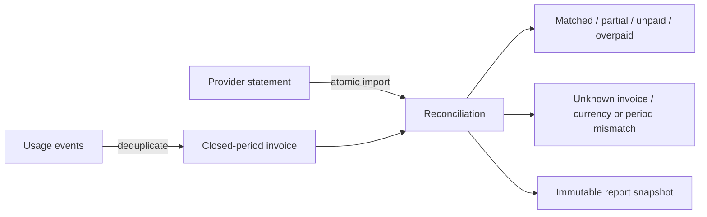

# BillTrace

[](https://github.com/the-devcraft/billtrace/actions/workflows/ci.yml)

**Usage invoicing with explainable payment reconciliation.**

A payment arriving twice should not double revenue. A currency mismatch should not quietly close an invoice. BillTrace makes those decisions explicit: import usage, issue a monthly invoice, load a provider statement, and inspect a reproducible reconciliation report.

Built with Python, FastAPI, Pydantic and SQLite. Small enough to run locally without external services; structured around the accounting boundaries that are easy to get wrong.



## Run it

Python 3.12 or 3.13:

```sh
python -m venv .venv
# macOS/Linux: source .venv/bin/activate
# Windows PowerShell: .venv\Scripts\Activate.ps1
python -m pip install -r requirements-dev.lock
python -m pip install --no-deps -e .
python examples/walkthrough.py
```

The walkthrough uses a temporary database and the real HTTP handlers. It submits a usage retry, issues a $7.00 invoice, imports a $6.50 payment, then prints:

```json
{
  "currency": "USD",
  "amount_cents": 700,
  "received_cents": 650,
  "delta_cents": -50,
  "status": "partial"
}
```

To run a persistent API:

```sh
billtrace init
billtrace tenant "Example workspace"
billtrace serve
```

Provisioning returns a tenant ID and a random API key once. Store the key securely; only its SHA-256 digest is stored in the database. Send it as `Authorization: Bearer <key>`. Interactive API documentation is at **http://127.0.0.1:8000/docs**. Use `billtrace revoke <tenant-id>` to disable that tenant's key.

## Rules that matter

- **Integer money.** USD, EUR and GBP use integer minor units. Rates are fixed per customer; this version bills whole units at a flat rate.
- **Tenant scope.** The authenticated key selects the tenant. Callers cannot supply a tenant ID or read another tenant's invoice or report.
- **Payload-aware retries.** Reusing an event, customer, batch or payment reference with changed data returns a conflict. Exact retries do not write another financial record.
- **Sealed periods.** Only completed UTC calendar months can be invoiced. Issuing an invoice seals that customer's month against new usage. Exact retries still work after sealing.
- **Atomic imports.** A conflicting payment rolls back the entire batch, including its audit record. One bad row cannot leave a half-imported statement.
- **Explainable allocation.** A receipt is matched by invoice ID, billing period and currency. Mismatches remain visible and never contribute to a matched invoice total.
- **Stable evidence.** Repeating reconciliation against unchanged input returns the same report ID and digest. New receipts produce a new snapshot; old reports remain available.

## API surface

| Endpoint | Purpose |
|---|---|
| `POST /v1/customers` | Register an immutable customer rate and currency |
| `POST /v1/usage` | Ingest a uniquely identified usage event |
| `POST /v1/invoices` | Issue or retrieve a customer's monthly invoice |
| `GET /v1/invoices` | List a billing period with bounded pagination |
| `GET /v1/invoices/{id}` | Retrieve one tenant-scoped invoice |
| `POST /v1/statements` | Import up to 500 provider payment records atomically |
| `POST /v1/reconciliations` | Create or retrieve an input-identical snapshot |
| `GET /v1/reconciliations/{id}` | Retrieve historical reconciliation evidence |
| `GET /v1/audit` | Read a cursor-paginated audit trail |
| `GET /health` | Check database connectivity |

All `/v1` routes require a tenant API key. See [API semantics](docs/api.md) for payloads and conflicts.

## Checks

```sh
python -m ruff check src tests tools examples
python -m ruff format --check src tests tools examples
python -m mypy
python -m pytest
python -m pip_audit -r requirements.lock
```

CI runs lint, formatting, strict typing, tests with a coverage gate, the walkthrough and a production dependency audit. Tests use actual temporary SQLite databases, concurrent connections and the HTTP boundary; they do not contact a payment provider. The [verification notes](docs/verification.md) distinguish executed checks from untested deployment properties.

## Design and operating limits

SQLite is intentional for a single-instance, local-first service. `BEGIN IMMEDIATE` serializes write transitions, foreign keys preserve tenant relationships, and triggers reject updates/deletes to billing and audit records. These controls do not protect against an administrator who can modify the database file or remove triggers.

This is a reconciliation service, not a payment processor or a complete accounting system. It does not charge cards, calculate tax, handle refunds, support rate changes or corrections, or claim regulatory compliance. Reconciliation is by **billing period**, not bank settlement date. Review [architecture](docs/architecture.md), [operations](docs/operations.md), and [security](SECURITY.md) before any deployment.

## Project notes

Original implementation; no source files from the reference repositories were imported. See [provenance](docs/provenance.md). [MIT licensed](LICENSE).
